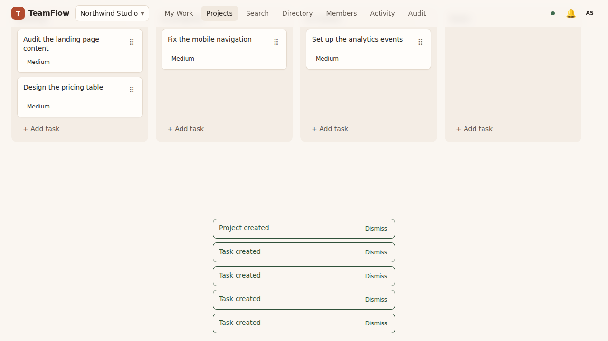
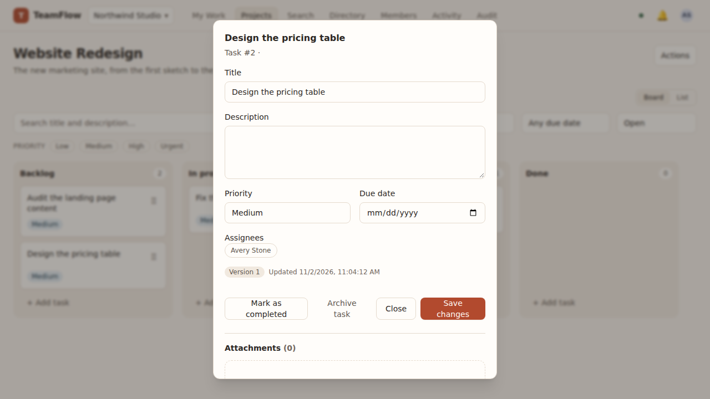
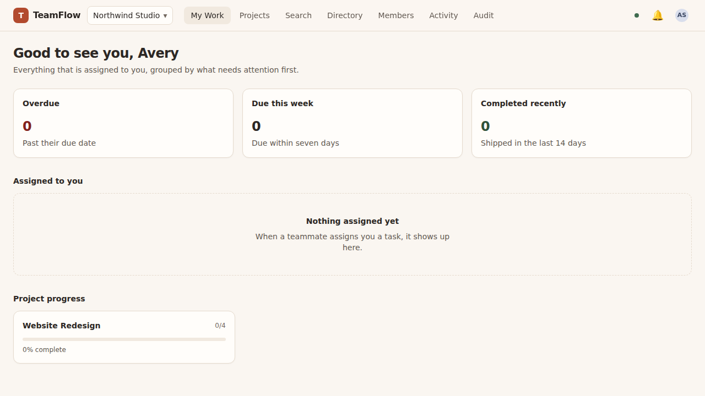

# TeamFlow — Multi-Tenant Project Management SaaS

> Multi-tenant project-management platform with role-based access, Kanban workflows, authenticated
> real-time collaboration, attachments and audit trails.

**Status:** M0–M5 implemented. The foundation (M0), the workspaces, boards and collaboration
(M1–M3) are merged; **M4 and M5** — attachments, role administration, audit log, search and
filters, the session management, the end-to-end journeys, the accessibility audit, the benchmark
and the deployment guide — are in the pull request that carries this branch. The remaining gaps
are listed in [`docs/out-of-scope.md`](docs/out-of-scope.md).

---

## Screenshots

The images are produced by the real application: the CI job **Screenshots** runs the Playwright
suite `apps/web/e2e/screenshots.spec.ts` against a real stack and commits the PNGs into
`docs/screenshots/`. No mock-up is ever shipped.

| The board                                             | The task dialog                                           | My Work                                                |
| ----------------------------------------------------- | --------------------------------------------------------- | ------------------------------------------------------ |
|  |  |  |

---

## Documentation

| Document                                                       | Purpose                                                                                                                     |
| -------------------------------------------------------------- | --------------------------------------------------------------------------------------------------------------------------- |
| [`docs/product-requirements.md`](docs/product-requirements.md) | Personas, role/capability matrix, functional requirements, acceptance criteria                                              |
| [`docs/architecture.md`](docs/architecture.md)                 | System context, repository layout, data model, request pipeline, ordering and real-time design                              |
| [`docs/api-conventions.md`](docs/api-conventions.md)           | Envelopes, error codes, auth, pagination, filtering, concurrency, idempotency, rate limits, attachments, real-time protocol |
| [`docs/threat-model.md`](docs/threat-model.md)                 | Assets, trust boundaries, 17 threats with mitigations and the tests that verify them                                        |
| [`docs/deployment.md`](docs/deployment.md)                     | The images, the environment, the release procedure, the backup, the monitoring and the release checklist                    |
| [`docs/benchmarks.md`](docs/benchmarks.md)                     | The measured latency of the API and the limits of the measurement                                                           |
| [`docs/out-of-scope.md`](docs/out-of-scope.md)                 | What is deliberately _not_ in v1                                                                                            |
| [`docs/adr/`](docs/adr)                                        | Architecture decision records (monorepo, sessions, tenancy, ordering, contracts, storage, hashing, Rust-free Prisma client) |
| [`infra/README.md`](infra/README.md)                           | The Docker Compose stack and the local setup without Docker                                                                 |

---

## Repository layout

```
apps/
  api/       NestJS 11 API — REST under /api/v1, Socket.IO under /socket.io
  web/       Next.js 15 (App Router) web application
packages/
  contracts/ Shared Zod schemas and types
  database/  Prisma schema, generated client, SQL migrations, ordering helpers
  ui/        Accessible design-system primitives
docs/        Specification, architecture, threat model, deployment, benchmarks, ADRs
infra/       Docker Compose stack and the Dockerfiles
```

npm workspaces (see [ADR 0001](docs/adr/0001-monorepo-npm-workspaces.md)).

---

## Delivery

| Milestone | Scope                                                                                                    | State             |
| --------- | -------------------------------------------------------------------------------------------------------- | ----------------- |
| **M0**    | Specification, architecture, threat model, ADRs                                                          | ✅ merged (PR #1) |
| **M1**    | Monorepo, Prisma schema and SQL migrations, NestJS + Next.js shell, sessions, organizations, seed, CI    | ✅ merged (PR #2) |
| **M2**    | Projects, boards, columns, tasks, sparse ordering, labels, search, tenant-isolation tests, responsive UI | ✅ merged (PR #2) |
| **M3**    | Comments, mentions, notifications, authenticated WebSocket rooms, activity timeline, concurrency         | ✅ merged (PR #2) |
| **M4**    | Attachments, role administration, audit log, sessions, search and filters, rate limiting, access log     | 🟡 this branch    |
| **M5**    | Playwright journeys, mobile viewport, accessibility audit, screenshots, benchmark, deployment guide      | 🟡 this branch    |

---

## Features

**Workspaces and access**

- Multi-tenancy by construction — every organization-owned row carries `organizationId`, every
  query is scoped by it, and a cross-tenant identifier resolves to `404`, never to data.
- Roles `owner`, `admin`, `member`, `viewer` map to capabilities in a single policy module.
- Invitations with an expiry and a single use, a member directory with the join date and the
  open tasks of every member, and a role administration screen.
- Opaque sessions in `HttpOnly` cookies (hashed at rest), revocation per session and
  "sign out everywhere", CSRF protection and a rate-limited sign-in.

**Boards and tasks**

- Projects with boards, columns and a WIP limit, tasks with assignees, labels, priority, due
  date, description and attachments.
- Drag-and-drop **and** a keyboard alternative ("Move to…"): the board is fully operable
  without a pointer.
- The order is stored as a sparse numeric position, so a move writes exactly one row.
- Optimistic concurrency: a task carries a version, and a conflict rolls the client back.
- Search and filters over the tasks of a project and of the whole workspace, plus the global
  search page with a deep link into the board.

**Collaboration**

- Comments with `@mentions` that notify the mentioned people, editing and deleting, and the
  activity timeline of every task and of the workspace.
- Authenticated real-time rooms — a socket without a session is rejected, and every room is
  re-authorised against the tenant of the session.
- Presence: who is looking at a task right now.

**Operations**

- Attachments with a storage abstraction (local driver and documented S3 driver), a size and
  type limit, random storage keys and authorized downloads that are never served inline.
- An append-only audit log with a restricted view for owners and admins.
- A consistent error envelope with stable codes, pagination, idempotency keys, request ids, one
  structured log line per request, and health and readiness probes.

---

## Principles

- **Tenant isolation by construction.** Every organization-owned row carries `organizationId`, and
  every query is scoped by it. Cross-tenant identifiers resolve to `404`, never to data.
- **Server-managed sessions.** Opaque tokens in `HttpOnly` cookies, hashed at rest, individually and
  globally revocable. No long-lived tokens in browser storage.
- **One authorization matrix.** Roles (owner / admin / member / viewer) map to capabilities in a
  single policy module; controllers never compare roles ad hoc.
- **Honest artifacts.** No invented test results, users, deployments or performance claims. What
  is not built is listed in [`docs/out-of-scope.md`](docs/out-of-scope.md), and the latency in
  [`docs/benchmarks.md`](docs/benchmarks.md) is measured by a script that anyone can run.
- **Reviewable increments.** Each milestone is a focused pull request with its own commands,
  results, risks and follow-ups.

---

## Quick start

### With Docker

```bash
cp .env.example .env          # set SESSION_SECRET
docker compose -f infra/docker-compose.yml up --build
```

The web app is served on <http://localhost:3000>, the API on <http://localhost:4000>.

### Without Docker

The repository ships the PostgreSQL binaries of `@embedded-postgres/linux-x64`, so the whole stack
runs without a container runtime:

```bash
npm install
npm run db:generate            # Prisma client (Rust-free, see ADR 0008)
npm run db:local               # starts a throwaway Postgres and prints a DATABASE_URL
export DATABASE_URL="postgresql://postgres@127.0.0.1:<port>/teamflow?schema=public"
npm run db:migrate             # applies the SQL migrations
npm run build:packages
npm run dev                    # API on :4000, web on :3000
```

`npm run db:seed` creates a demo organization ("Northwind Studio"), a project with a board,
columns and a few tasks. The seed is deterministic and uses fictional accounts
(`ada@teamflow.dev`, `grace@teamflow.dev`, `alan@teamflow.dev`, password `TeamFlow!2026`) — no
real person or customer data.

---

## Commands

| Command                | Purpose                                                            |
| ---------------------- | ------------------------------------------------------------------ |
| `npm run build`        | Builds contracts, database, ui, api and web                        |
| `npm run typecheck`    | Type checks every workspace                                        |
| `npm run lint`         | ESLint (flat config) over the repository                           |
| `npm run format:check` | Prettier check                                                     |
| `npm test`             | Jest (API integration tests) and Vitest (web, contracts, database) |
| `npm run test:e2e`     | Playwright journeys against a running stack                        |
| `npm run db:generate`  | Regenerates the Prisma client                                      |
| `npm run db:migrate`   | Applies the pending SQL migrations                                 |
| `npm run db:seed`      | Seeds the demo data                                                |
| `npm run db:local`     | Starts the embedded Postgres                                       |
| `npm run benchmark`    | Measures the latency of the API (`--workspace @teamflow/api`)      |

### Test status

| Suite           | Command                                        | Result                     |
| --------------- | ---------------------------------------------- | -------------------------- |
| API integration | `npm run test --workspace @teamflow/api`       | 7 suites, 55 tests passing |
| Contracts unit  | `npm run test --workspace @teamflow/contracts` | 1 file, 8 tests passing    |
| Web unit        | `npm run test --workspace @teamflow/web`       | 2 files, 14 tests passing  |
| Database unit   | `npm run test --workspace @teamflow/database`  | 1 file, 10 tests passing   |
| End to end      | `npm run test:e2e`                             | 6 specs, run in CI         |

The Playwright specs run in the CI workflow against a real stack (Postgres, API and web app):
the sign-up and sign-in, the board with the drag-and-drop and the keyboard alternative, the
complete journey (register → invite a teammate → project → task → move → comment with a mention
→ activity), the workflow on a phone (390 × 844), an accessibility scan with axe-core and the
screenshots of this README. They are **not** executed in the development sandbox, because no
browser binary is installed there.

---

## Design notes

- **Warm, neutral palette with a single accent.** The UI uses one terracotta accent on a warm
  neutral background; status colours are reserved for state, never for decoration. Every text
  and background pair meets the WCAG 2.2 AA contrast ratio.
- **The board works without a pointer.** Tasks can be dragged, and every card additionally offers
  a "Move to…" menu, so the board is fully operable with the keyboard.
- **Optimistic updates roll back.** A task move updates the cache immediately and restores the
  previous state when the request fails.
- **The browser stays on its own origin.** The Next server proxies `/api/v1/*` to the API, so the
  session cookie is always first-party. The WebSocket handshake goes to the API directly and is
  authorised with the same session cookie.
- **The visible focus, the reduced motion and the empty states are part of the design.** Every
  interactive element has a visible focus ring, `prefers-reduced-motion` is respected, and every
  list has a loading, an empty and an error state.

---

## Limitations

The v1 limitations are tracked explicitly in [`docs/out-of-scope.md`](docs/out-of-scope.md):

- password-only authentication — no SSO, no MFA and no email delivery for the invitations,
- the rate limiter lives in the process of the API, so it is per instance and not global,
- the WebSocket rooms are held in the memory of the instance, so a horizontal scale needs a
  Socket.IO adapter,
- the search is a substring match over the title and the description — a trigram index would be
  the next step for very large projects,
- attachments are download-only and are streamed through the API; there is no preview and no
  virus scanning.

No hosted environment, uptime figure or performance claim is made by this repository. The
latency in [`docs/benchmarks.md`](docs/benchmarks.md) was measured in a container with two vCPUs
and is labelled with its limits.
