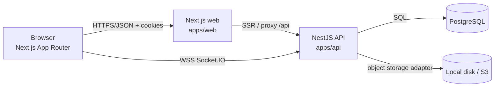
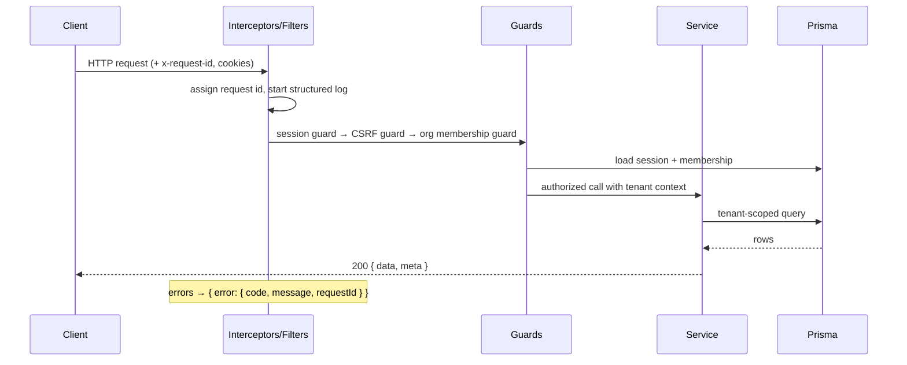
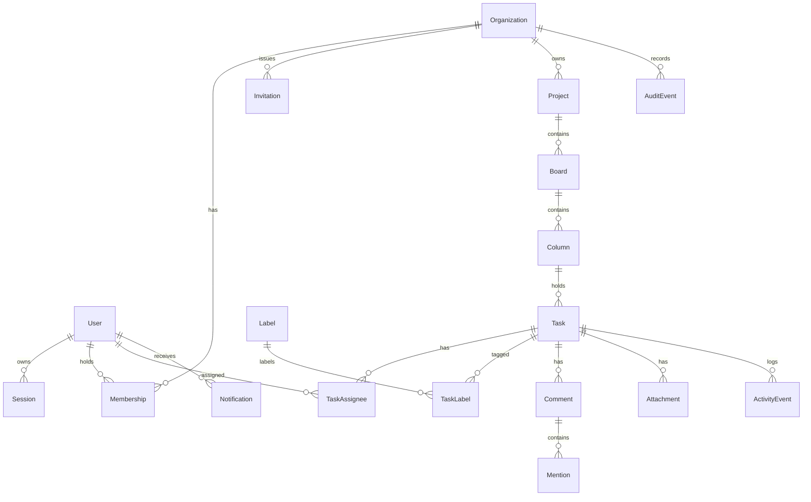

# TeamFlow — Architecture

## 1. System context



The browser never talks to the database. The API is the only component that holds database
credentials, enforces authorization and emits audit events.

There is **no Redis** in v1: the sessions, the rate limit and the presence live in Postgres or
in the memory of the API process. The trade-off and the moment a shared store becomes
necessary are documented in [ADR 0002](./adr/0002-session-auth.md) and in
[out-of-scope.md](./out-of-scope.md).

## 2. Repository layout

```text
apps/
  api/          NestJS REST API + Socket.IO gateway + Jest integration tests
  web/          Next.js App Router frontend (React 19) + Vitest unit tests + Playwright journeys
packages/
  database/     Prisma schema, SQL migrations, deterministic seed, client factory
  contracts/    Zod schemas + inferred types shared by API and web (single source of truth)
  ui/           Accessible design-system primitives (Radix based) + design tokens
infra/          Dockerfiles and compose fragments for production-shaped deployments
docs/           Product spec, architecture, threat model, ADRs, API conventions
scripts/        Local development helpers (test database bootstrap, seeding)
```

npm workspaces manage the dependency graph. `packages/*` are consumed as workspace packages; the
web app imports `contracts` for request/response validation and `ui` for presentational
components. The API imports `contracts` for DTO validation and `database` for the Prisma client.

## 3. Component responsibilities

### 3.1 apps/api (NestJS)

| Module                | Responsibility                                                               |
| --------------------- | ---------------------------------------------------------------------------- |
| `AuthModule`          | Registration, sign-in/out, opaque sessions, CSRF, session revocation.        |
| `UsersModule`         | User records and password verification.                                      |
| `OrganizationsModule` | Organizations, memberships, invitations, member directory.                   |
| `ProjectsModule`      | Projects, boards, columns, tasks, labels, ordering, search.                  |
| `CollaborationModule` | Comments, mentions, activity events, notifications.                          |
| `AttachmentsModule`   | Upload/download pipeline and the storage abstraction.                        |
| `AuditModule`         | Append-only audit trail and its restricted read API.                         |
| `RealtimeModule`      | Socket.IO gateway, room authorization, event fan-out.                        |
| `HealthModule`        | Liveness and readiness probes.                                               |
| `CommonModule`        | Error envelope, pagination, idempotency, rate limiting, request id, logging. |

### 3.1.1 The attachments

The upload never writes a file into the database. A `StorageDriver` interface
(`apps/api/src/modules/attachments/storage.ts`) describes what the API needs from a store:

```text
put(key, body: Buffer, contentType) -> void
get(key) -> { stream, size } | null
delete(key) -> void
```

Two drivers implement it: the local one (the default in development, files in `var/uploads`)
and the S3 one (`STORAGE_DRIVER=s3`). The key is random (a UUID plus a random suffix, sharded
into two directories), the name of the file is stored in the row and never used to build a path. The download is authorized again and
is sent as an attachment with `X-Content-Type-Options: nosniff`. See
[ADR 0006](./adr/0006-attachment-storage.md).

**Request pipeline**



Authorization is centralized in `apps/api/src/common/authz/` — a single capability matrix
(`permissions.ts`) plus `PolicyService`. Controllers never perform ad-hoc role comparisons.

### 3.2 apps/web (Next.js)

- **App Router** with server components for initial data and client components for interaction.
- **Route handlers / rewrites** under `/api/*` proxy to the Nest API so the browser stays
  same-origin; session cookies are `HttpOnly` and never readable by JavaScript.
- **TanStack Query** for server state, giving cache invalidation, optimistic updates and rollback.
- **dnd-kit** for pointer drag-and-drop with a keyboard sensor; a "Move to…" menu provides an
  equivalent non-pointer path.
- **Radix UI** primitives for dialogs, menus and popovers (focus trapping, escape handling,
  aria wiring) styled with the TeamFlow tokens in `packages/ui`.

### 3.3 packages/database

- Prisma schema with explicit `organizationId` on every tenant-owned model and composite indexes
  that lead with `organizationId`.
- SQL migrations are committed; `prisma migrate deploy` is the only supported way to provision a
  database.
- A deterministic seed creates two organizations, a shared demo password and boards with labels,
  priorities and due dates so that the UI has realistic (but fictional) data.

### 3.4 packages/contracts

- Zod schemas for every request body, query string and response payload.
- The API validates inputs with these schemas (custom Nest pipe) and the web builds typed
  clients from the same definitions, so a contract change breaks compilation on both sides.
- Inferred TypeScript types (`z.infer`) are the only types crossing the network boundary.

## 4. Data model



Every tenant-owned entity carries `organizationId`. Cross-tenant access is rejected in the query
itself (`where: { organizationId }`), not by a post-fetch check, so there is no window in which
another tenant's row is loaded into memory.

## 5. Ordering strategy

A task stores a **sparse numeric position** (`bigint`) between its neighbours. Inserting or
moving a task computes the midpoint of the gap and writes exactly one row — the neighbours keep
their positions, so a drag never renumbers a whole column. The stride between two neighbours is
`1_000_000_000`; when the gap is exhausted, only the touched column is rebalanced.

The details (including the meaning of `afterTaskId`) are in
[ADR 0004](./adr/0004-fractional-ordering.md).

## 6. Real-time design

- Transport: Socket.IO (WebSocket with a long-polling fallback).
- Handshake authentication: the session cookie is validated against the `Session` table; a missing
  or revoked session closes the socket with an `unauthorized` error.
- Rooms: `org:<organizationId>`, `project:<projectId>`, `task:<taskId>`. Joining a room requires
  an active membership; unauthorized joins are rejected and audited.
- Events are emitted by the API services (`task.created`, `task.updated`, `task.moved`,
  `comment.created`, `comment.updated`, `notification.created`, `presence.updated`) and are the
  _same_ payloads the REST endpoints return.
- The presence is **ephemeral**: it lives in the memory of the gateway, is broadcast when a
  client joins or leaves a task room and is never written to the database.
- Client-side optimistic updates reconcile with the broadcast payload; a version mismatch triggers
  a rollback and a refetch.

## 7. Failure behaviour

| Failure                           | Behaviour                                                                                    |
| --------------------------------- | -------------------------------------------------------------------------------------------- |
| Postgres unreachable              | `/ready` returns `503`; requests fail with `503 database_unavailable`; no stack traces leak. |
| The storage driver is unreachable | The upload fails with `500 internal_error`; the row is not written.                          |
| WebSocket disconnect              | The client refetches the affected queries on reconnect.                                      |
| Optimistic-concurrency conflict   | `409 conflict` with the current server representation.                                       |

The rate limiter lives in the process of the API. With more than one instance every instance
has its own counter — the limit is therefore per instance, not global. This is documented in
[out-of-scope.md](./out-of-scope.md) and is the reason a shared store would be needed for a
horizontal scale.

## 8. Deployment shape

`infra/` contains Dockerfiles for the API and web tier. The web tier terminates TLS and proxies
`/api` and the WebSocket upgrade to the API tier. Postgres is managed by the operator.

See [`docs/deployment.md`](./deployment.md) for the release procedure, the environment, the backup
and the honest limitations, and [`docs/benchmarks.md`](./benchmarks.md) for the measured latency
of the API.
