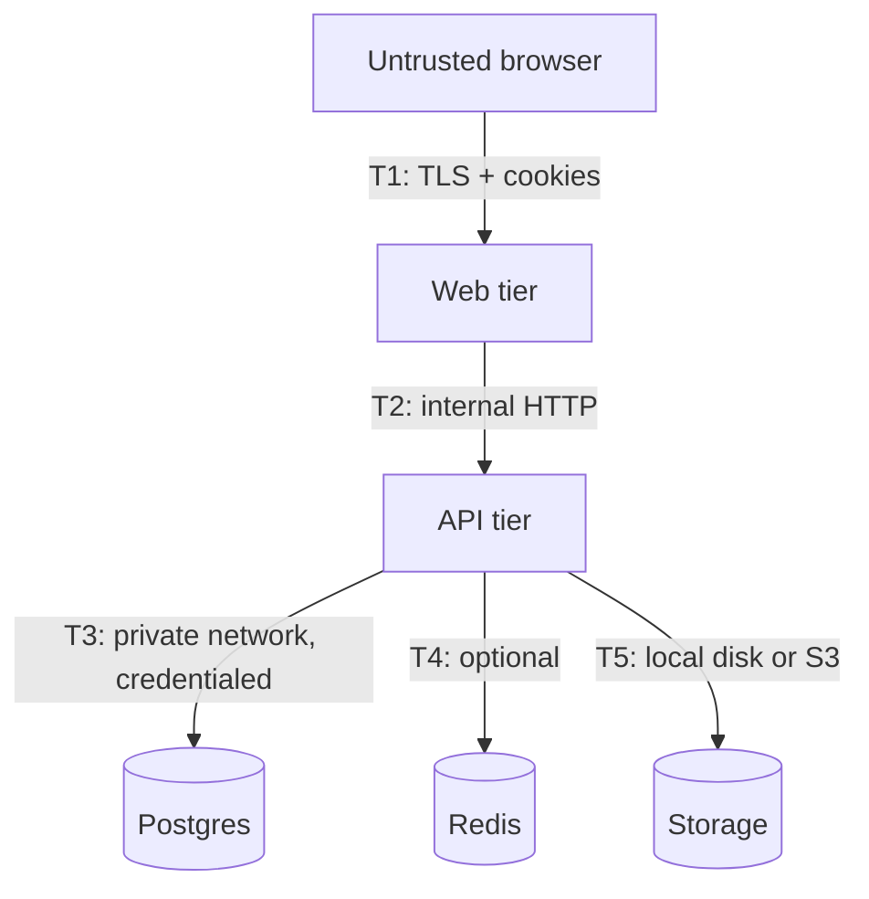

# TeamFlow — Threat model (v1)

Scope: the web tier, the API tier, the Postgres database, the optional Redis instance and the
attachment storage adapter. Assumed deployment: TLS terminated at the web tier, all tiers in a
private network, Postgres not exposed publicly.

## 1. Assets

| Asset | Confidentiality | Integrity | Availability |
| --- | --- | --- | --- |
| Credentials (password hashes) | High | High | Medium |
| Session tokens | High | High | High |
| Tenant data (projects, tasks, comments) | High | High | High |
| Attachments | Medium | High | Medium |
| Audit trail | Medium | High | Medium |
| Invitation links | Medium | High | Low |

## 2. Trust boundaries

- **T1** — the only boundary exposed to the internet.
- **T2** — the web tier is semi-trusted: it holds no authorization logic of its own and never
  talks to the database.
- **T3/T4/T5** — the API tier is the only principal with data access.

## 3. Threats and mitigations

| # | Threat | Mitigation | Verified by |
| --- | --- | --- | --- |
| T-01 | **Broken tenant isolation** — user A reads org B's tasks | Every query is scoped by `organizationId` derived from the caller's membership; cross-tenant ids return `404` | `tenant-isolation.spec.ts` (API integration suite) |
| T-02 | **Credential stuffing / brute force** | `scrypt` hashing with per-user salt, generic failure message, rate limits per IP and per account, audit of failed sign-ins | `auth.spec.ts` |
| T-03 | **Session theft via XSS** | Session cookie is `HttpOnly` + `SameSite`; no tokens in `localStorage`; CSP restricts script sources | code review + CSP header tests |
| T-04 | **CSRF on state-changing requests** | Session-bound double-submit token required on every non-idempotent request, `SameSite=Lax` cookies | `csrf.spec.ts` |
| T-05 | **Privilege escalation via role change** | Single capability matrix; owners cannot be demoted or removed by admins; last-owner invariant | `invitations.spec.ts` |
| T-06 | **Unauthorized real-time subscription** | Socket handshake validates the session; room joins re-check membership and are rejected otherwise | `realtime.spec.ts` |
| T-07 | **IDOR on attachments** | Download handler re-resolves tenant + membership before streaming; keys are random | `attachments.spec.ts` |
| T-08 | **Malicious upload (polyglot / SVG / HTML)** | Allow-list of MIME types, size cap, randomized keys, `Content-Disposition: attachment`, `X-Content-Type-Options: nosniff`, never served inline | `attachments.spec.ts` |
| T-09 | **Path traversal in uploads** | Filenames are sanitized and never used for storage paths; the stored key is a random UUID in a sharded directory | unit tests |
| T-10 | **Mass assignment / over-posting** | Zod schemas strip unknown keys; role fields are not accepted on member update payloads | `validation.spec.ts` |
| T-11 | **SQL injection** | Prisma parameterizes all queries; no raw SQL with user input | code review |
| T-12 | **Information disclosure through errors** | Global exception filter maps errors to a stable envelope; stack traces only in server logs | `error-envelope.spec.ts` |
| T-13 | **Replay of invitation links** | Invitations are single-use, expire, store only a hash of the token, and are consumed inside a transaction | `invitations.spec.ts` |
| T-14 | **Denial of service via unbounded lists** | Pagination caps, rate limits, body size limits, upload size caps | `pagination.spec.ts` |
| T-15 | **Stale write / lost update** | Optimistic concurrency via `version`; conflicts return `409` and the client rolls back | `concurrency.spec.ts` |
| T-16 | **WebSocket message spoofing** | Server is authoritative; client events are only "join/leave" hints that are re-authorized server-side | `realtime.spec.ts` |
| T-17 | **Secret leakage in git / logs** | `.env` ignored, CI uses repository secrets, logs redact cookies and passwords | CI + `.gitignore` |

## 4. Explicitly accepted risks for v1

- **No MFA.** Password-only authentication is offered; adding TOTP is planned post-v1.
- **Rate limiting is per-instance** while running without Redis. A multi-instance deployment
  without Redis loses global rate-limit accounting (documented in the deployment guide).
- **Attachments are served through the API**, so large downloads consume API memory/bandwidth.
  A presigned-URL S3 adapter is the documented production path.
- **No email delivery.** Invitations are surfaced as links in the UI and printed by the seed
  script; there is no outbound mail integration.
- **Audit log is append-only by convention**, not by database constraint. A privileged database
  user can still delete rows.

## 5. Out of scope

- Multi-region failover, disaster recovery and backup restoration drills.
- Automated dependency scanning beyond what GitHub Actions provides (Dependabot is enabled).
- Formal verification of the whole system; the suite covers the threats listed above.
